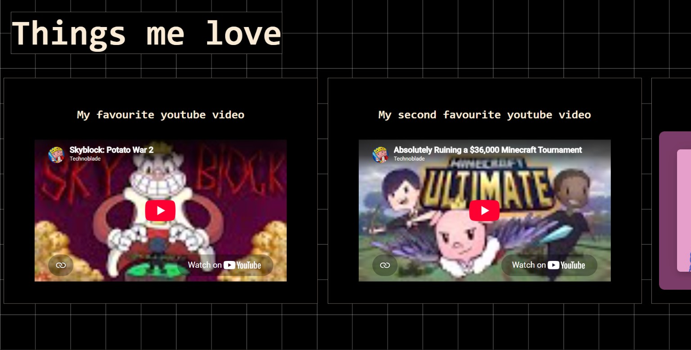
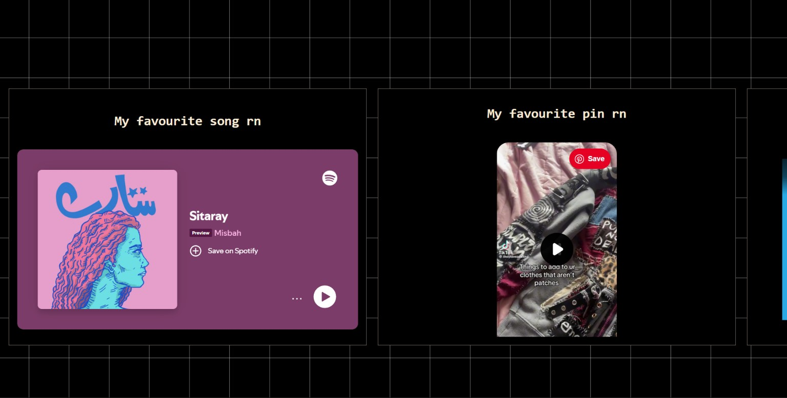
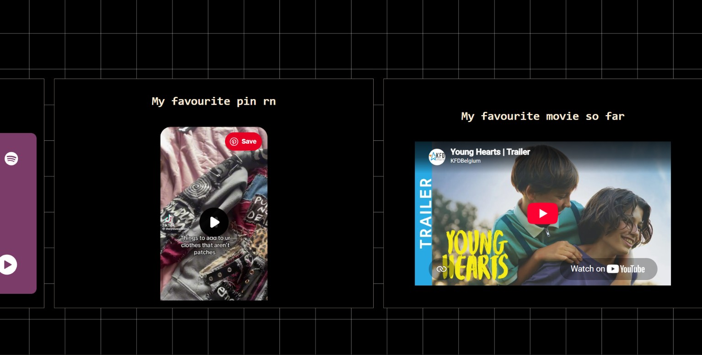

# THINGSMELOVE
**coded by: Mukul**

I have coded this personal website to showcase different things I personally love, like yt vids, films, or songs.
# My demo link


# Tech stack
Program used: Visual Studio Code
Languages used: CSS and HTML

# What does it do?
makes me happy. (jk)
It's a project i've been wanting to do for a very long time, this website showcases my favourite things i love so i can show it to other people.

# How did i make it?
* I made a rough sketch on paper on how i want it to look
* I created all necessary files.
* Then, i began with index.html and added main heading text.
* From then, i added a grid system that showcases my content in a grid system.
* I added my content and comments for code readability.

# Problems i faced
* How to make a grid
* How to cleanly use embeds

# AI USAGE
None


# Screenshots




# How to run the project locally
Clone and run this repository:
```bash
git clone 